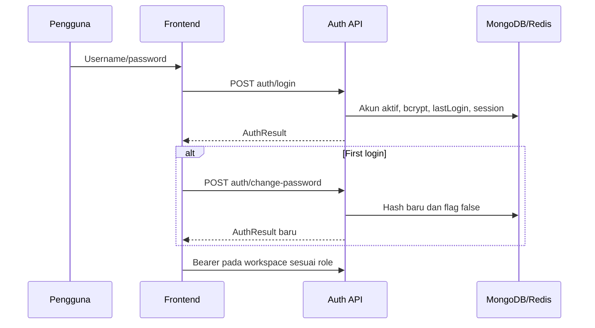
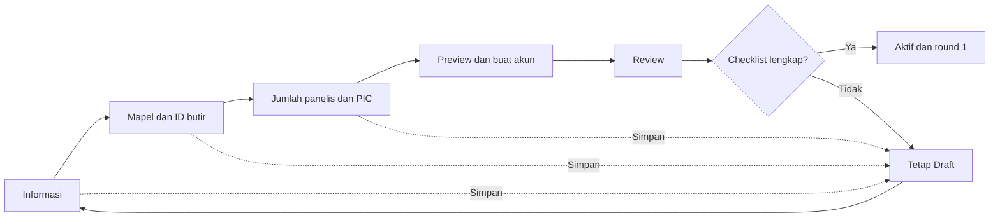
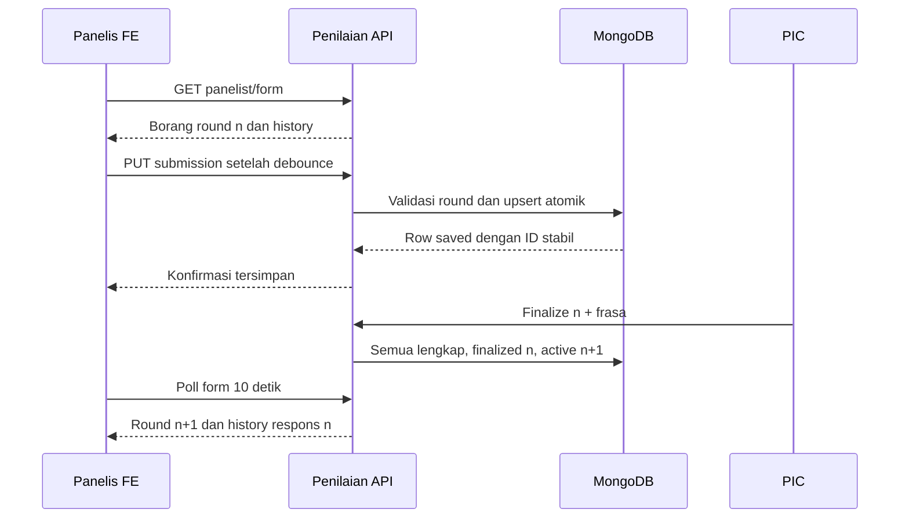
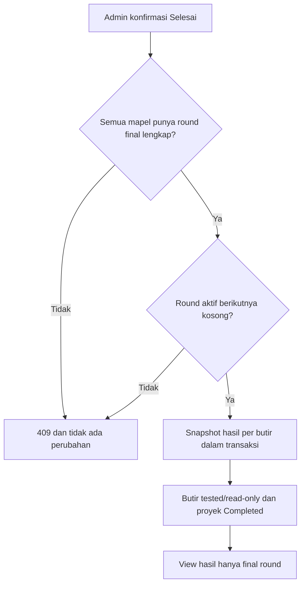

# Fitur dan alur API Standard Setting

Pembaruan 20 Oktober 2026: [fitur kontak/revisi/snapshot/audit](FEATURES-2026-10-19.md), [laporan/dampak/evaluasi](../../docs/features/reporting-impact-evaluation.md), dan [OpenAPI lengkap](openapi.yaml) mencakup route helper terbaru. Gate kontak memakai `428 CONTACT_REQUIRED`, konteks stale `409 REVISION_CONFLICT`, di luar periode `422 PERIOD_CLOSED`; login 429 mengirim `Retry-After`, dan kontrol keamanan gagal 503.

Source dan retest: 13 Oktober 2026. Seluruh path API relatif ke `http://localhost:8080/api/v1`; halaman FE default `http://localhost:5176`. Kontrak lengkap: [OpenAPI](openapi.yaml). [QA retest](qa/QA-2026-10-13-RETEST.md) tidak mengganti laporan historis.

## Konvensi, autentikasi dan grant

Browser memanggil backend langsung dengan Content-Type application/json dan Bearer accessToken dari session localStorage. Sukses memakai HTTP 200 dengan `{"status":"success","data":...}`; error memakai status error/message dan errors pada activation checklist. Array kosong berupa []. 401 sesi/credential tidak valid; 403 role/scope salah; 428 first-login belum selesai; 422 payload/jawaban/checklist tidak valid; 409 konflik status/alokasi/konfirmasi/lifecycle. Error monitoring/form dipetakan handler ke 404.

Middleware memverifikasi JWT lalu membaca akun aktif dari MongoDB. Role, projectId, subjectCode, nama dan mustChangePassword memakai data akun terbaru. Akun dinonaktifkan tidak dapat memakai JWT lama. Admin punya grant proyek/bank/akun dan monitoring global; PIC hanya monitoring/preview/round pada penugasannya; Panelis hanya borang dan respons sendiri. FE guard per-role melengkapi, bukan menggantikan grant backend.

Perubahan proyek/alokasi/akun/round/submission/completion memakai transaksi MongoDB snapshot + majority. Replica set wajib, termasuk single-node lokal; [prasyarat deployment](MIGRATION.md#replica-set-untuk-transaksi-p1). Tidak ada fallback non-atomik.

## Inventaris 25 operasi

| Endpoint | Grant | Fitur |
| --- | --- | --- |
| GET /health | Publik | Liveness HTTP; bukan pemeriksaan dependency ulang. |
| POST /auth/login | Publik | Login credential aktif. |
| POST /auth/refresh | Publik | Rotasi refresh sekali pakai. |
| POST /auth/change-password | Semua akun authenticated | Password baru + session baru. |
| GET /me | Semua role, password selesai | UserView dengan id, scope aktif dan contactRequired terkini (bukan claims JWT). |
| GET /projects | Admin | Daftar proyek. |
| POST /projects | Admin | Draft baru. |
| GET /projects/{id} | Admin | Detail/resume konfigurasi. |
| PUT /projects/{id} | Admin | Edit Draft. |
| DELETE /projects/{id} | Admin | Hapus Draft/lepas butir/nonaktifkan akun. |
| POST /projects/{id}/activate | Admin | Buka proyek lengkap dan round 1. |
| POST /projects/{id}/complete | Admin | Snapshot final dan flag tested. |
| POST /projects/{id}/accounts/generate | Admin | Buat/rekonsiliasi akun proyek. |
| GET /users | Admin | Daftar akun, filter projectId. |
| GET /items | Admin | Bank butir/filter metadata. |
| POST /items | Admin | Tambah/edit butir available. |
| GET /items/{id} | Admin | Metadata asli untuk edit/view. |
| GET /items/{id}/result | Admin | Snapshot final + respons final. |
| GET /projects/{id}/monitoring | Admin | Progres mapel dipilih. |
| GET /projects/{id}/panelists/{panelistId}/submissions | Admin | Preview panelis dipilih. |
| GET /pic/monitoring | PIC | Monitoring penugasan. |
| GET /pic/panelists/{panelistId}/submissions | PIC | Preview read-only. |
| POST /pic/rounds/{action} | PIC | Finalize/rollback. |
| GET /panelist/form | Panelis | Borang aktif/final dan history sendiri. |
| PUT /panelist/submissions/{itemId} | Panelis | Upsert satu respons valid. |

## Login, first-login, refresh dan logout

Halaman /login mengirim POST /auth/login dari input username/password:

```json
{"username":"superadmin","password":"<input pengguna>"}
```

Backend memeriksa active/bcrypt, mengisi lastLoginAt dan menerbitkan access JWT (15 menit) serta refresh Redis (7 hari). TTL mengikuti konfigurasi auth. Response data mempunyai accessToken, refreshToken, expiresIn dan user tanpa passwordHash. FE menyimpan expiresAt lalu menuju /ganti-password bila mustChangePassword=true; selain itu Admin /admin/proyek, PIC /pic, Panelis /panelis.

Pada /ganti-password, FE memeriksa minimal 6 karakter dan kesamaan setelah berhenti input atau submit. Confirmation hanya FE; request:

```json
{"currentPassword":"<input>","newPassword":"<input minimal 6 karakter>"}
```

POST /auth/change-password dapat diakses sebelum passwordChanged. BE memvalidasi current bcrypt, minimal 6 byte dan berbeda dari current. Password/flag diperbarui, response berupa AuthResult session baru. FE mengganti access/refresh/user seluruhnya; protected request berikutnya tidak memerlukan login ulang. Jika session issuance gagal setelah hash berubah, login kembali menggunakan password baru.

401 dengan refresh memanggil POST /auth/refresh `{"refreshToken":"<session>"}`; Redis GETDEL mengonsumsi token lama lalu menerbitkan pasangan baru. FE menyatukan request refresh paralel agar polling tidak mengonsumsi token yang sama dua kali. Logout menghapus session FE; belum ada endpoint revokasi/logout server.



## Daftar proyek, hybrid wizard dan resume

/admin/proyek mengambil GET /projects pada mount. Pencarian/status/count memakai data server, tanpa demo. Kolom aksi berisi Lanjutkan untuk Draft, Ubah Konfigurasi per langkah untuk Aktif; Selesai terkunci secara struktural, hapus Draft dengan konfirmasi, monitoring dan tandai selesai untuk Aktif.

Tahap 1 Informasi: nama, deskripsi dan periode berasal dari input. FE mengubah tanggal YYYY-MM-DD menjadi awal/akhir hari UTC (bukan tengah malam Asia/Jakarta). POST /projects bila belum ada id, PUT /projects/{id} bila id telah diberikan server. Contoh:

```json
{
  "name":"Standard Setting Oktober",
  "description":"Catatan pelaksanaan",
  "startDate":"2026-10-13T00:00:00Z",
  "endDate":"2026-10-31T23:59:59Z",
  "wizardStep":1,
  "subjects":[]
}
```

Server menentukan id/code/status Draft, createdBy dari akun, timestamps dan kepemilikan. Update hanya Draft; client tidak dapat mengubah status/code/createdBy/createdAt atau memalsukan ID personel. SaveProject memvalidasi urutan periode, subject/item ganda, metadata mapel, kemudian menyelaraskan alokasi dan Project secara atomik. Bila request gagal, FE tetap di tahap yang sama dan tidak mengaku tersimpan.

Tahap 2 Daftar Mapel: katalog FE MAT/BIN/IPA; tiap mapel membuka drawer GET /items?subjectCode={row.code}&onlyAvailable=false. Filter ON “Hanya ID butir belum diuji” diterapkan lokal, termasuk butir available atau allocated milik Draft ini. Matikan filter untuk melihat item proyek lain/tested, tetapi tidak dapat memilihnya. Pencarian dan bentuk soal lokal. Checkbox menyusun itemIds; Tambahkan ke Mapel mengubah state, Simpan Draft/Lanjut mempersistensinya. Chevron menampilkan list itemIds.

Tahap 3 personel: masukkan picName, panelistCount dan panelistNames. Bentuk subject:

```json
{"code":"MAT","name":"Matematika","itemIds":["MAT-001","MAT-002"],"picName":"PIC A","panelistCount":2,"panelistNames":["Panelis A","Panelis B"]}
```

Perubahan nama/jumlah atau mapel membatalkan accountsGenerated; akun perlu direkonsiliasi sebelum aktivasi.

Tahap 4 akun: preview username lokal tidak berarti akun sudah dibuat. Saat melanjutkan, POST /projects/{id}/accounts/generate mengirim account input dari nama/role/mapel:

```json
{"accounts":[
  {"name":"PIC A","role":"pic_mapel","subjectCode":"MAT"},
  {"name":"Panelis A","role":"panelis","subjectCode":"MAT"},
  {"name":"Panelis B","role":"panelis","subjectCode":"MAT"}
]}
```

BE mewajibkan satu PIC dan jumlah Panelis sesuai konfigurasi. Username berasal dari code proyek + mapel + role/index. Password akun baru berasal dari INITIAL_PASSWORD dan bcrypt, bukan payload FE; first-login wajib. Generate ulang mempertahankan ID/password/flag existing berdasarkan slot personel stabil, memperbarui nama, serta mempertahankan status nonaktif; akun proyek yang dihilangkan dinonaktifkan. Users + assignment Project disimpan dalam transaksi. FE mengambil Project lagi setelah response; tidak membuat generated ID semu.

Tahap 5 review: POST /projects/{id}/activate tanpa body. Wajib Draft, identitas/periode valid, mapel/items, akun aktif scope sesuai, PIC dan jumlah panelis lengkap, accountsGenerated=true. Checklist tidak lengkap menghasilkan 422/errors; status tidak sesuai 409. Aktivasi dan pembukaan round 1 tiap mapel atomik. FE navigasi kembali hanya sesudah sukses.

Resume /admin/proyek/{id}/konfigurasi memanggil GET /projects/{id} dan GET /users?projectId={id}, menghidrasi nilai tanggal/personel lama. Draft dan Aktif dapat diedit per langkah; daftar butir hanya sebelum respons tersimpan. Selesai terkunci secara struktural. Versi konfigurasi mencegah stale overwrite. Simpan Draft dapat dilakukan di setiap tahap; proyek belum lengkap tidak dapat diaktifkan.



Hapus Draft: DELETE /projects/{id} dengan `{"confirmation":"HAPUS PROYEK"}`, id/frasa berasal dari row/modal. Hanya Draft; transaksi melepas item, menonaktifkan akun dan menghapus Project. Respons `{"deleted":true}`. Data akun retained inactive, bukan dihapus fisik.

## Akun dan bank ID butir

/admin/akun mengambil GET /users dan /projects. Filter projectId dan pencarian lokal; API GET /users?projectId={id} juga tersedia. Role global Admin ditampilkan terpisah, proyek global tidak dihitung sebagai proyek asal. Status active dan lastLoginAt mengikuti server. CSV dibuat browser dari row terfilter, tanpa endpoint ekspor/password/token.

Bank mengambil GET /items, mendukung query subjectCode/projectId/onlyAvailable. Tambah dan Edit membuka ItemDrawer. Edit/view mengambil GET /items/{id}; item allocated hanya view disabled, tested menuju hasil. Simpan mengirim POST /items:

```json
{"items":[{"id":"MAT-013","subjectCode":"MAT","subjectName":"Matematika","questionType":"essay","maxScore":4,"rubric":["Catatan skor"]}]}
```

ID/mapel/type/maxScore berasal dari input drawer; rubric textarea dipisah per baris. PG maxScore=1; non-PG 1–100. Server menetapkan available/timestamp dan menolak update allocated/tested. Item batch diproses atomik. Belum ada importer UI.

## Monitoring, preview, laporan dan round PIC

Admin /admin/proyek/{id}/monitoring?subject={code} memakai GET /projects/{id}/monitoring?subjectCode={code}; ID berasal dari row, kode dari query/selector mapel. PIC /pic memakai GET /pic/monitoring tanpa query; optional override hanya boleh sama dengan scope akun.

Dashboard load mount + setiap 10000 ms. Data mencakup project, subject, round, history, items, panelists, statistics, totalDone/totalItems, canFinalize/canRollback. Round aktif untuk project Aktif; round finalized terakhir untuk Selesai. done menghitung item valid unik dalam alokasi dari panelis ditugaskan. Status Selesai bila semua, Menilai bila sebagian, Perlu Perhatian bila sebagian dan >24 jam, Belum Menilai bila kosong. lastActive=null bila belum ada aktivitas; bukan tahun 1. Donut dihitung dari proporsi aktual. Statistik tes hanya tersedia setelah semua panelis/item lengkap; selain itu null dan FE tanda —. Rumus pada [model data](MODEL-DATA.md). ICC tidak diimplementasikan, angka konstanta dihapus.

Preview PIC: GET /pic/panelists/{panelistId}/submissions?round={n}. Admin: GET /projects/{id}/panelists/{panelistId}/submissions?subjectCode={code}&round={n}. PanelistId berasal dari row, round dari data.round.number; harus integer positif. Service memverifikasi user ditugaskan pada proyek/mapel tersebut. Drawer menampilkan seluruh alokasi beserta respons real atau —, jumlah per tipe, read-only dan polling 10 detik. Admin tidak menggunakan endpoint PIC.

Unduh Laporan menghasilkan CSV browser dari row monitoring aktual. Timestamp sinkron hanya berubah sesudah request sukses; bila polling gagal, FE menampilkan error dan menandai data terakhir, tidak demo.

Finalisasi/rollback PIC mempunyai dua tahap UI: penjelasan dampak, lalu frasa tepat. Eksekusi satu request POST /pic/rounds/finalize atau /rollback:

```json
{"confirmation":"FINALISASI PUTARAN","roundNumber":1}
```

RoundNumber ditangkap saat modal dibuka; server mencocokkan round aktif untuk menolak aksi stale. Finalize wajib proyek Aktif, PIC assignment tepat, seluruh panelis/item respons valid lengkap. Transaksi finalized n dan membuka n+1. Rollback wajib n>1, menandai n rolled_back dan mengaktifkan n−1; respons retained. Reopen memakai ID/nomor existing sehingga finalize setelah rollback tidak duplikat. canFinalize/canRollback mengendalikan tombol, tetapi BE tetap validasi.

## Borang, autosave dan history Panelis

GET /panelist/form pada mount + setiap 10 detik tanpa query/body; scope berasal dari akun. Respons berisi project, subject, round, items, submissions sendiri pada round tersebut, history metadata, previousRound/previousSubmissions dari finalized sebelumnya dan readOnly. Draft ditolak tanpa membuat round. Project Selesai menampilkan putaran final read-only.

FE menginisialisasi answers sebelum menerbitkan form, memakai copy value/distribution tanpa structuredClone proxy. Saat round berubah, timer/save lama dibatalkan, borang baru dipasang dan history nyata ditampilkan. Polling round yang sama tidak menimpa isian lokal yang belum tersimpan.

Input menjadwalkan debounce 700 ms per butir. PG integer 0–100; PG Kompleks/Essay integer 0–100 per kategori dan total tepat 100, length sesuai maxScore+1. Input kosong bukan nol. PUT /panelist/submissions/{itemId}:

```json
{"roundNumber":1,"answer":{"questionType":"pilihan_ganda","value":72}}
```

```json
{"roundNumber":1,"answer":{"questionType":"essay","distribution":[5,15,25,35,20]}}
```

ItemId dari row, roundNumber dari form, answer dari input; nama/user/scope tidak dikirim. Backend memeriksa active project/user assignment/current round/item ownership/readOnly/type/distribution. Transaksi menyentuh round untuk berserialisasi dengan finalisasi; upsert scope mempertahankan ID existing. Response berupa row Submission saved.

FE menyerialisasi save per item; hanya versi terbaru yang sukses dapat menandai saved. Error tetap belum tersimpan, progress tidak bertambah, pesan/retry tersedia. Simpan Draft mem-flush jawaban valid yang belum tersimpan; bukan collection Draft terpisah. Lanjut ke Butir Berikutnya hanya scroll. Reload mengambil nilai dari server; beforeunload memperingatkan perubahan yang belum tersimpan.



## Penyelesaian dan hasil final

Admin POST /projects/{id}/complete `{"confirmation":"SELESAIKAN PROYEK"}`. Wajib Aktif; setiap mapel mempunyai round finalized lengkap, dan active round berikutnya tidak mempunyai respons yang belum difinalisasi. Bila sudah mulai mengisi round berikutnya, selesaikan/finalisasikan dahulu; jangan membuang data secara diam-diam.

Dalam satu transaksi, BE menghitung snapshot finalResult tiap item dari panelis unik/round finalized terakhir, menandai tested/readOnly dan project Completed, serta menutup active round kosong sebagai closed. Tidak mencampur semua putaran. Semua butir tetap dimiliki proyek tersebut dan tidak dapat dipakai proyek lain.

Halaman /admin/butir/{id} memanggil GET /items/{id}/result. Response data: item, statistics snapshot atau null, responses hanya final round, warning opsional. Tested legacy tanpa snapshot memberi warning dan responses [], bukan mengarang cutoff nol. Ekspor Hasil menghasilkan CSV browser respons final.



## Batas fitur

Redis dipakai untuk refresh; monitoring saat ini membaca MongoDB, bukan cache. Template/impor XLSX, katalog mapel dinamis, reset password dan status aktif peserta tersedia. Tidak ada export PDF server, endpoint logout global, notifikasi atau role switch. CSV/laporan/ekspor sudah dibuat lokal dari data nyata. Tidak ada API untuk edit respons panelis oleh Admin/PIC. Lihat [Known Issues](KNOWN-ISSUES.md) untuk P2 dan prasyarat deployment.

## Kontrak administrasi 14 Oktober 2026

Endpoint baru dan schema tercantum pada [OpenAPI](openapi.yaml). Penjelasan seluruh alur pengguna, aturan impor/akun/monitoring dan rumus ada pada [panduan terbaru](../../frontend-ss/docs/ADMIN-2026-10-14.md). Semua endpoint administrasi menggunakan grant admin_super.
