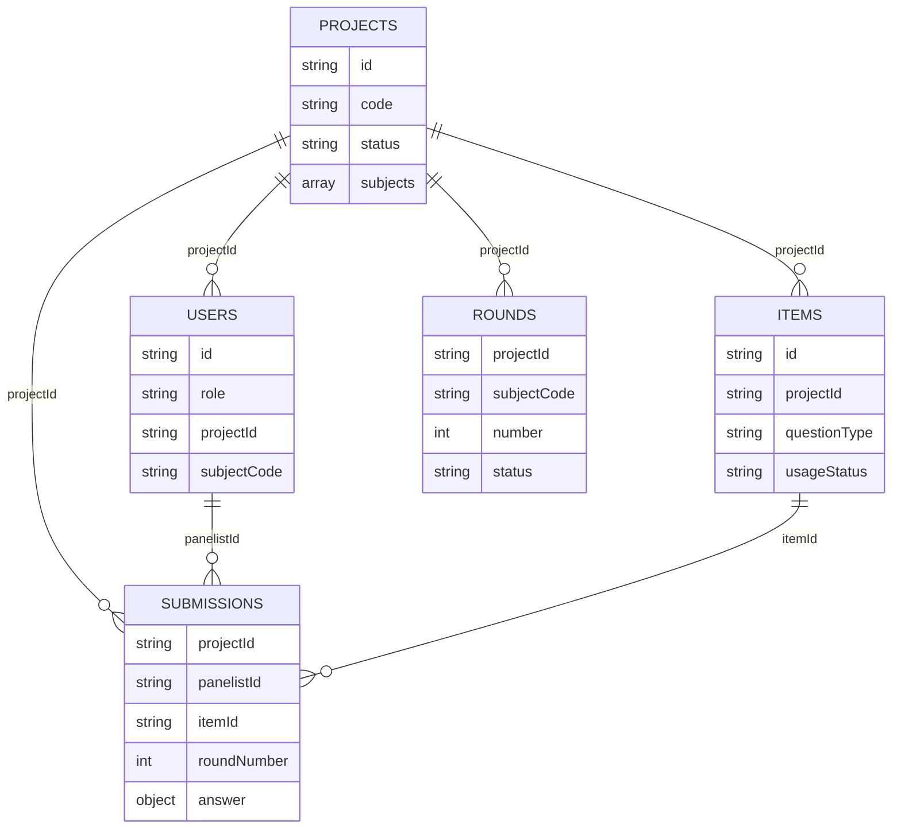

# Model Data, Index, dan Statistik

MongoDB URI default `mongodb://localhost:27017`, database `standard-setting`. Dokumen account berada di collection **users**, bukan collection singular user. API menerjemahkan BSON `_id` ke JSON `id`. ID user/project/round/submission adalah string, bukan ObjectId.

## Collection bisnis

| Collection | Field dan fungsi utama |
| --- | --- |
| users | `_id`, username, name, passwordHash (bcrypt; tidak diekspor JSON), role, projectId/projectName, subjectCode, mustChangePassword, active, lastLoginAt opsional, createdAt/updatedAt. Admin bootstrap tanpa scope proyek; PIC/Panelis berscope. |
| projects | `_id`, code, name, description, startDate/endDate, status, wizardStep, embedded subjects, accountsGenerated, createdBy, completedAt, timestamps. |
| items | `_id` berupa ID butir, subjectCode/name, questionType, maxScore, rubric, usageStatus, projectId/name, readOnly, finalResult opsional, timestamps. Satu item hanya memiliki satu projectId pada saat dialokasikan. |
| rounds | `_id`, projectId, subjectCode, number, status, endsAt/finalizedAt/by opsional, timestamps. |
| submissions | `_id`, projectId, subjectCode, roundNumber, panelistId/name, itemId, answer, status, updatedAt. Unit data: respons satu panelis pada satu butir/putaran. |

`projects.subjects[]` berisi code/name, itemIds, picUserId/picName, panelistCount, panelistUserIds/panelistNames. Nama dan username pengguna dibuat saat generate; projectId/mapel di JWT menentukan scope operasi.

Answer PG: `{"questionType":"pilihan_ganda","value":72}`. Answer PG Kompleks/Essay: `{"questionType":"essay","distribution":[5,15,25,35,20]}`. Index array adalah kategori skor, jumlah nilai distribusi tepat 100 kandidat.

Metadata migration: `schema_migrations` dengan `_id` integer version, name dan appliedAt UTC. Baseline versi 1 bernama `initial_schema`. Collection ini bukan data fitur user dan baru dibuat ketika `up` berhasil.

## Index aktual

Definisi berada di `internal/store/indexes.go`; digunakan startup dan migration. MongoDB menyediakan index `_id_` unique otomatis untuk setiap collection.

| Collection | Key berurutan | Unique | Nama default MongoDB |
| --- | --- | --- | --- |
| users | username asc | Ya | username_1 |
| users | projectId asc, role asc | Tidak | projectId_1_role_1 |
| projects | code asc | Ya | code_1 |
| projects | status asc | Tidak | status_1 |
| items | subjectCode asc, usageStatus asc | Tidak | subjectCode_1_usageStatus_1 |
| items | projectId asc | Tidak | projectId_1 |
| rounds | projectId asc, subjectCode asc, number asc | Ya | projectId_1_subjectCode_1_number_1 |
| submissions | projectId asc, subjectCode asc, roundNumber asc, panelistId asc, itemId asc | Ya | projectId_1_subjectCode_1_roundNumber_1_panelistId_1_itemId_1 |

Tidak ada foreign key, schema validator collection atau index partial satu active round. Service memvalidasi assignment/relasi; transaksi multi-document snapshot/majority mengamankan alokasi, akun, submission, round dan completion. Replica set wajib; lihat [deployment](MIGRATION.md#replica-set-untuk-transaksi-p1).

Round ditautkan secara logis ke submission melalui triple projectId+subjectCode+roundNumber, bukan roundId. `subjects` embedded dalam Project, tidak memiliki collection mapel terpisah.

## Lifecycle

- Project: draft saat dibuat; active lewat activate setelah checklist; completed lewat complete saat masih active. Update hanya Draft; field status/code/createdBy/createdAt/personnel IDs ditentukan server.
- Item: available -> allocated ketika dipilih/disimpan proyek -> tested/readOnly ketika admin menyelesaikan proyek. Item allocated yang dibuang dari konfigurasi Draft atau dilepas saat hapus Draft menjadi available. Dengan demikian batas "satu proyek" adalah alokasi bersamaan/sekali diuji; alokasi Draft yang dibatalkan masih dapat dipakai proyek lain.
- Round: active -> finalized saat finalize, kemudian n+1 active; rollback menandai n rolled_back dan mengaktifkan n-1. Nomor diindex unique per proyek/mapel; reopen memakai ID existing. Completion menutup round aktif kosong menjadi closed.
- Submission: saved bila valid; upsert key menghindari dua respons dengan kombinasi scope yang sama. FindOneAndUpdate menyimpan field mutable dan memakai setOnInsert untuk ID baru; ID existing tetap, satu row per scope.

## Statistik hasil butir dan monitoring

Completion menghitung dan menyimpan `Item.finalResult` dari **putaran finalized terakhir tiap mapel**, seluruh panelis unik ditugaskan dan jawaban valid lengkap. Snapshot memuat roundNumber dan completedAt. Endpoint hasil membaca snapshot serta respons hanya nomor putaran tersebut. Tiap jawaban dinormalisasi 0–100:

- PG: `x = value`.
- PG Kompleks/Essay: `x = sum(score * jumlahKandidatPadaScore) / maxScore`. Karena total distribusi 100, hasil adalah persentase skor maksimal. Contoh `[10,20,35,35]`, maxScore=3: `(0*10 + 1*20 + 2*35 + 3*35)/3 = 65`.
- Mean = sum(x)/jumlah respons. Cutoff saat ini sama dengan mean.
- Median = nilai tengah sorted; untuk n genap, rerata dua tengah.
- Standard deviation memakai simpangan baku **populasi** `sqrt(sum((x-mean)^2)/n)`.
- Minimum/maximum dari nilai sorted. `panelistCount` adalah panelis unik ditugaskan dengan respons lengkap.
- Data kosong tidak dapat difinalisasi/diselesaikan. Monitoring incomplete mengembalikan statistics=null; tested legacy tanpa snapshot memberi warning, bukan hasil nol buatan.

Contoh manual PG 60, 70, 80: cutoff/mean/median 70, SD sekitar 8,165, rentang 60-80, panelistCount 3. Tidak ada perhitungan ICC di backend; konstanta ICC dihapus dari dashboard.

Monitoring menghitung skor tes setiap panelis sebagai sum(nilaiItemPersen × maxScoreItem) / sum(maxScoreItem), kemudian statistik antar panelis, hanya setelah semua lengkap. Ini berbeda dari hasil satu item. Dataset regresi PG 60/80, kompleks nilai 100 (max3), Essay 50 (max4) menghasilkan skor tes 70/72,5; mean 71,25 dan SD 1,25. Metode ini didokumentasikan dari source, bukan klaim validasi eksternal spreadsheet.

## Redis

Redis default `localhost:6379`, database 0. `ss:session:<refreshToken>` memuat userId dan TTL 7 hari. Refresh memakai GETDEL sehingga token lama tidak dapat dipakai ulang. JWT access 15 menit tidak disimpan di Redis. Logout FE belum merevoke refresh token.

Prefix cache `ss:cache:<key>` dan TTL parameter tersedia pada adapter. Belum ada call cache dalam `Monitoring`, sehingga data monitoring saat ini bukan hasil cache Redis. Redis tidak memerlukan migration collection/index.
