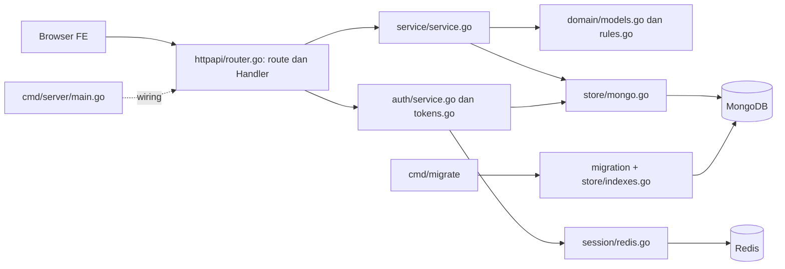

# Struktur Direktori dan Tanggung Jawab Aplikasi

Snapshot source diperbarui: 13 Oktober 2026. Dokumen ini menjawab lokasi router, controller, logika bisnis, repository database, komponen FE, konfigurasi, test dan migration.

## Peta workspace

```text
Fira BP3/
├── README.md                         # Pintu masuk aplikasi di halaman Git
├── backend-ss/                       # Runtime BE Standard Setting
│   ├── cmd/server/main.go            # Wiring, env, seed, start dan shutdown HTTP
│   ├── cmd/migrate/main.go           # CLI status / up / seed MongoDB
│   ├── internal/
│   │   ├── httpapi/router.go          # Router + controller/handler + middleware
│   │   ├── httpapi/router_test.go
│   │   ├── auth/service.go           # Login, refresh, password, bcrypt
│   │   ├── auth/tokens.go            # Claims dan JWT HS256
│   │   ├── auth/service_test.go
│   │   ├── domain/models.go          # Model JSON/BSON dan enum
│   │   ├── domain/rules.go           # Validasi dan aturan domain
│   │   ├── domain/*_test.go
│   │   ├── service/service.go        # Proyek/akun/bank butir + interface Store
│   │   ├── service/grading.go        # Borang, submission, round dan snapshot final
│   │   ├── service/monitoring.go     # Monitoring/preview dan statistik nyata
│   │   ├── store/mongo.go            # Query MongoDB, CRUD dan seed
│   │   ├── store/indexes.go          # Index bersama startup/migration
│   │   ├── store/mongo_test.go
│   │   ├── session/redis.go          # Refresh session dan primitive cache
│   │   └── migration/                # Baseline dan ledger migration + integration test
│   ├── docs/                         # Doktek, OpenAPI, QA historis
│   ├── scripts/                      # Builder PDF QA dan pemeriksaan docs
│   ├── docker-compose.yml            # MongoDB/Redis lokal, volume, healthcheck
│   ├── .env.example                  # Contoh environment; bukan loader
│   ├── go.mod / go.sum               # Module dan dependency lock
│   └── README.md
├── frontend-ss/                      # Runtime FE Standard Setting
│   ├── src/routes/                   # File-based routing SvelteKit
│   ├── src/lib/components/           # Shell, wizard, monitoring dan drawer
│   ├── src/lib/api/client.js         # Fetch, Bearer, refresh dan localStorage
│   ├── src/lib/stores/auth.js         # Store session
│   ├── src/lib/domain/               # Aturan/normalisasi/autosave/poll safety + tests
│   ├── src/lib/actions/dialog.js      # Focus trap, Escape dan restore focus
│   ├── src/lib/api/export.js         # CSV browser tanpa endpoint export
│   ├── src/lib/data/demo.js           # Referensi fixture lama; tidak dipakai runtime
│   ├── src/app.css                   # Styling global
│   ├── src/app.html / app.d.ts        # Template HTML dan tipe aplikasi
│   ├── docs/                         # Panduan FE dan per-role
│   ├── .env.example                  # PUBLIC_API_URL
│   ├── vite.config.js                # Host dev dan cakupan Vitest
│   ├── svelte.config.js              # Adapter Node + preprocess
│   ├── jsconfig.json                 # Konfigurasi JavaScript/check
│   ├── package.json / package-lock.json
│   └── README.md
├── docs/superpowers/                 # Catatan desain/rencana pembangunan
├── qa-artifacts/                     # Lokasi bukti uji historis (folder September kosong)
├── real-backend-lms/                 # Referensi gaya BE; tidak dipanggil runtime SS
├── rumah.go.id/                      # Referensi gaya FE; tidak dipanggil runtime SS
└── standard-setting-figma-source/    # Sumber desain terpisah
```

`node_modules`, `.svelte-kit`, dan `build` adalah dependency/hasil generate; bukan sumber untuk mengubah fitur. QA login PNG yang sudah ada bukan bukti screenshot dari pengujian role 16 September.

## Backend: router dan controller ada di mana?

**Router sekaligus controller berada di satu file:** [`internal/httpapi/router.go`](../internal/httpapi/router.go). `New(Config)` memasang Fiber, error recovery, CORS, prefix `/api/v1`, autentikasi, pengecekan first-login dan grant role. Metode `(*Handler).login`, `saveProject`, `picMonitoring`, `saveSubmission`, dan lain-lain adalah controller HTTP. Tidak ada folder `controllers` terpisah pada aplikasi ini.

Handler membaca `BodyParser`, `Params`, `Query`, atau claims JWT dari `c.Locals("claims")`, memanggil service, lalu membungkus response `success`/`errorResponse`. Handler tidak langsung menulis collection.

[`internal/service/service.go`](../internal/service/service.go) mengelola Project/akun/bank dan interface repository. [`grading.go`](../internal/service/grading.go) mengelola RoundAction, PanelistForm, SaveSubmission, CompleteProject dan ItemResult; [`monitoring.go`](../internal/service/monitoring.go) mengelola Monitoring, PreviewPanelist serta perhitungan statistik. Interface `Store` membatasi kebutuhan database dan `Cache` menyiapkan primitive Redis. Cache sudah disuntikkan, tetapi monitoring belum memakainya.

[`internal/domain/models.go`](../internal/domain/models.go) mendefinisikan User, Project, ProjectSubject, Item, Round, Answer, Submission, ItemResult. [`rules.go`](../internal/domain/rules.go) berisi validasi jawaban, aktivasi, alokasi dan penyelesaian proyek. Tidak ada ORM/mapping table SQL.

[`internal/store/mongo.go`](../internal/store/mongo.go) mengimplementasikan interface repository service/auth. MongoDB menyimpan dokumen BSON; `ReplaceOne`, `UpdateOne`, `Find`, upsert stable-ID, filter scope dan wrapper transaksi berada di sini. [`indexes.go`](../internal/store/indexes.go) dipakai startup dan migration agar definisinya tidak berbeda.

[`internal/auth/service.go`](../internal/auth/service.go) memproses credential/first-login/session; [`tokens.go`](../internal/auth/tokens.go) membuat dan memvalidasi JWT. [`internal/session/redis.go`](../internal/session/redis.go) menyimpan refresh token, mengonsumsi token lewat GETDEL, dan menyediakan get/set/delete cache.

[`cmd/server/main.go`](../cmd/server/main.go) adalah composition root: koneksi MongoDB, ping Redis, seed admin/bank contoh, TTL auth, dependency wiring, Listen dan graceful shutdown. Ia membaca `os.Getenv`, tidak otomatis membaca `.env`.

[`cmd/migrate/main.go`](../cmd/migrate/main.go) adalah executable tambahan; [`internal/migration/migration.go`](../internal/migration/migration.go) membuat baseline collection/index dan ledger. Lihat [migration](MIGRATION.md).



## Frontend: route dan komponen

Semua route berikut adalah file `+page.svelte`; tidak ada REST proxy FE atau `+server.js` saat ini. Browser memanggil BE langsung melalui `PUBLIC_API_URL`.

| Halaman | File sumber | Komponen utama |
| --- | --- | --- |
| `/` | `src/routes/+page.svelte` | Layar loading; guard layout memilih tujuan. |
| `/login` | `src/routes/login/+page.svelte` | Form credential, authSession. |
| `/ganti-password` | `src/routes/ganti-password/+page.svelte` | Form dan helper password. |
| `/admin/proyek` | `src/routes/admin/proyek/+page.svelte` | Tabel proyek, modal hapus/selesai. |
| `/admin/proyek/baru` | `src/routes/admin/proyek/baru/+page.svelte` | ProjectWizard. |
| `/admin/proyek/[id]/konfigurasi` | `src/routes/admin/proyek/[id]/konfigurasi/+page.svelte` | ProjectWizard dengan projectId. |
| `/admin/proyek/[id]/monitoring` | `src/routes/admin/proyek/[id]/monitoring/+page.svelte` | MonitoringDashboard admin, query subject. |
| `/admin/akun` | `src/routes/admin/akun/+page.svelte` | Daftar/filter akun. |
| `/admin/butir` | `src/routes/admin/butir/+page.svelte` | Bank/filter butir. |
| `/admin/butir/[id]` | `src/routes/admin/butir/[id]/+page.svelte` | Statistik/respons hasil butir. |
| `/pic` | `src/routes/pic/+page.svelte` | AppShell PIC + MonitoringDashboard. |
| `/panelis` | `src/routes/panelis/+page.svelte` | Form, debounce autosave, progres. |

`src/routes/+layout.svelte` menjalankan guard session pada mount/afterNavigate, title/meta dan global CSS. `src/routes/admin/+layout.svelte` menambahkan AppShell/sidebar untuk semua halaman Admin. Guard role per halaman belum tersedia (lihat KI-08).

| File komponen/helper | Tanggung jawab |
| --- | --- |
| `AppShell.svelte` | Topbar identitas akun/scope, avatar, logout lokal dan menu Admin. |
| `ProjectWizard.svelte` | Lima tahap, draft, hydrate edit, drawer butir, account preview/generate, aktivasi. |
| `MonitoringDashboard.svelte` | Polling 10 detik, progress, ringkasan, konfirmasi aksi, membuka preview. |
| `PanelistPreviewDrawer.svelte` | Read-only response putaran/panelis yang dipilih. |
| `api/client.js` | Base URL, Content-Type/Bearer, error handling, refresh/retry dan persistence localStorage. |
| `stores/auth.js` | Reactive store session yang menulis/menghapus localStorage. |
| `domain/auth.js` | routeForUser, accessRedirect dan normalizeSession. |
| `domain/password.js` | Minimum password, validasi submit dan match/mismatch feedback. |
| `domain/project.js` | canActivate, nextIncompleteStep, isItemSelectable, hydrateProjectForEdit. |
| `domain/scoring.js` | Validasi nilai/distribusi dan progressOf. |
| `data/demo.js` | Fixture presentasi lama; tidak lagi diimport oleh runtime. |
| `app.css` | Palet teal, tabel grid, modal/drawer, responsive dan typography. |

## Saat mengubah fitur

Urutan yang disarankan: periksa halaman/komponen FE dan payload `apiFetch`, cocokkan handler dalam router, baca service, lalu query store/domain. Perubahan kontrak harus disertai pembaruan `docs/openapi.yaml` dan [alur fitur](FITUR-DAN-ALUR-API.md). Perubahan index perlu migration baru setelah baseline diterapkan; jangan hanya mengubah versi yang sudah tercatat.

## Konfigurasi dan test

Environment BE: HTTP_ADDRESS, MONGO_URI, MONGO_DATABASE, REDIS_ADDRESS/PASSWORD/DATABASE, JWT_SECRET, INITIAL_PASSWORD, CORS_ORIGINS. Environment FE: PUBLIC_API_URL. Compose hanya mengelola database/cache; belum memiliki service build backend/frontend atau Dockerfile runtime.

Go test memverifikasi auth/domain/router/store; migration integration test memakai MongoDB scratch. Vitest mencakup helper auth/password/project/scoring, bukan otomatis seluruh browser workflow. `svelte-check` membaca `jsconfig.json`; test yang hijau tidak meniadakan temuan runtime QA.
